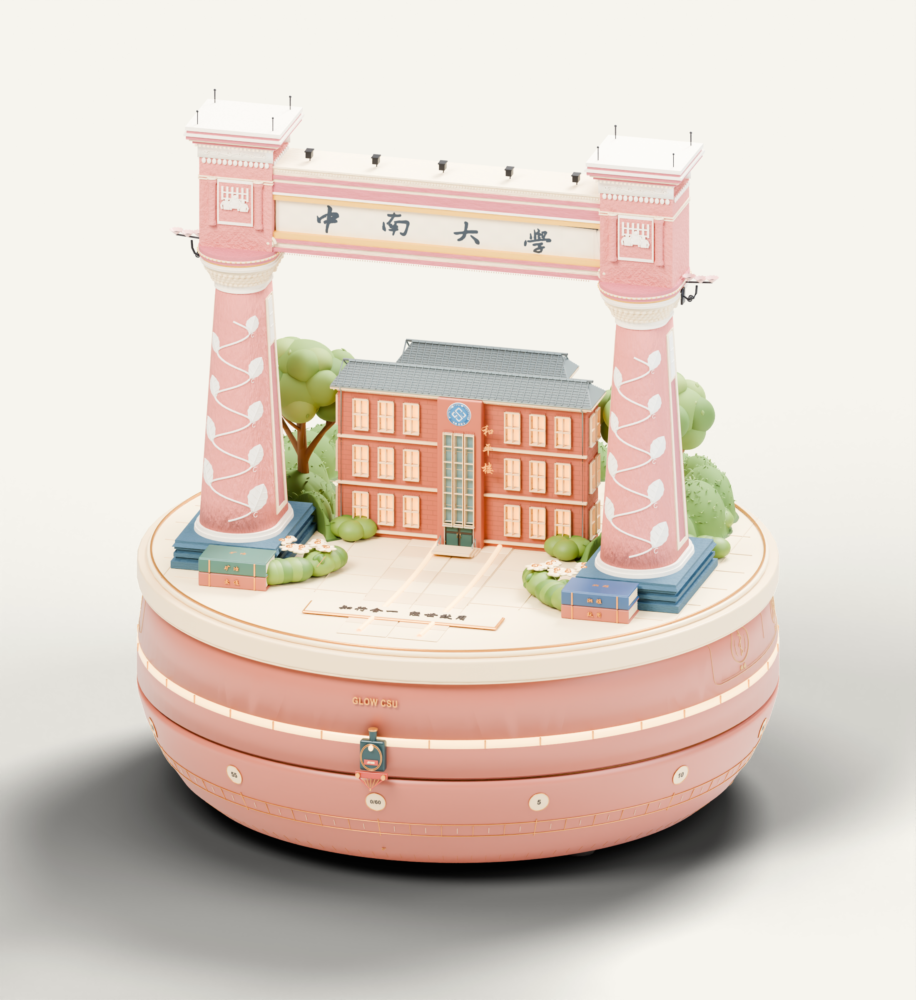
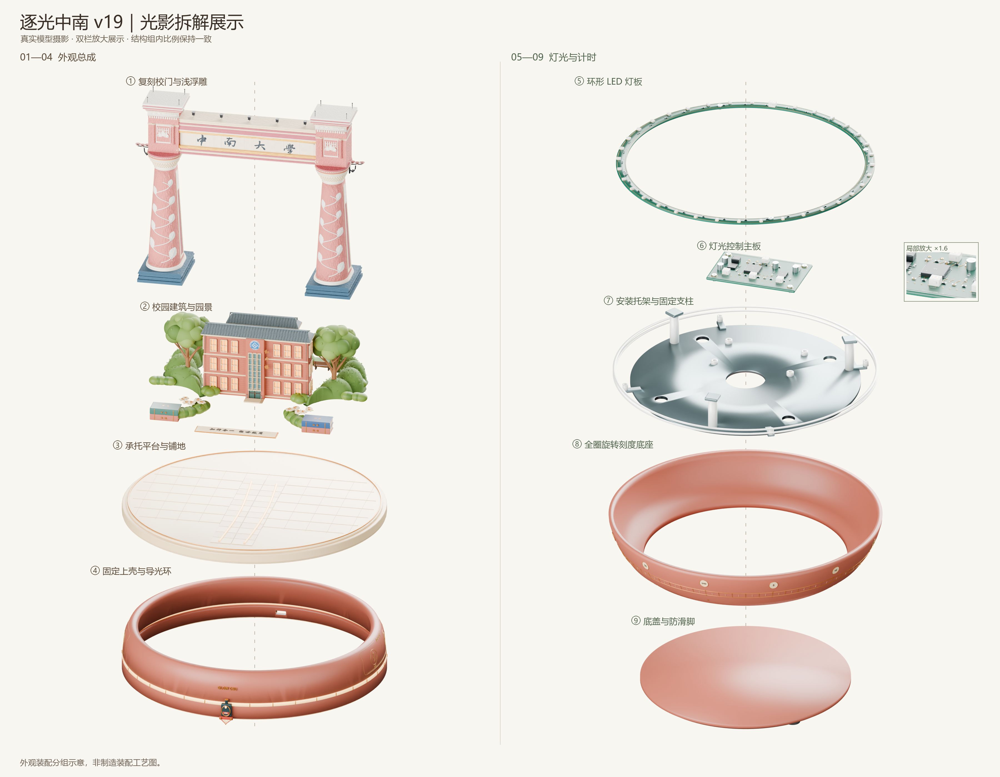
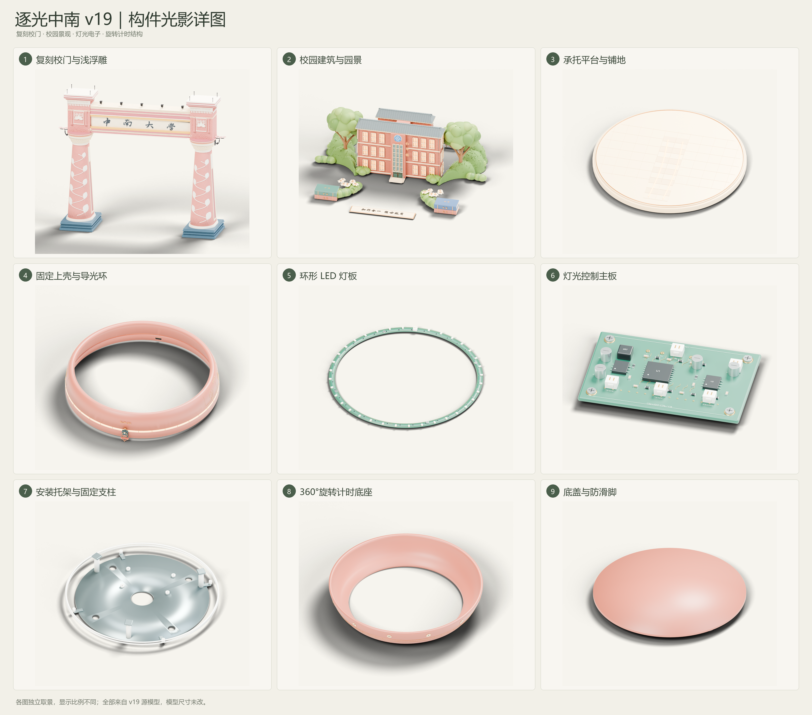
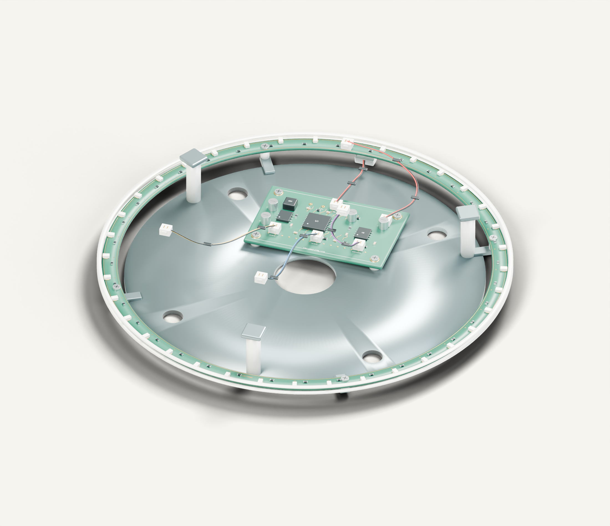

# 逐光中南 · Glow CSU

以中南大学校园记忆为主题的桌面计时器三维设计：复刻校门、校园建筑与园景置于旋转计时底座上，结合天心火车头指针、校园文化浅浮雕与灯光电子结构。

**当前最终模型为 v19。** 本仓库展示最终模型、25 张光影重拍图片，以及摄影、分组和只读校验相关源码。可编辑 Blender 源文件随仓库提供，完整交换模型和图集通过 **[Releases](https://github.com/sunfleeting-debug/glow-csu-campus-timer/releases/tag/v19-final)** 下载。



[查看整机转台 GIF](assets/animation/product-turntable.gif) · [下载 v19 最终交付](https://github.com/sunfleeting-debug/glow-csu-campus-timer/releases/tag/v19-final)

## 设计与结构

| 部分 | v19 内容 |
| --- | --- |
| 校门 | 40 件构件组成的复刻锥柱总成，宽 **146.25 mm**、深 **38.80 mm**、高 **121.23 mm**；柱轴距 **106.63 mm** |
| 台面 | 直径 **165 mm** 的承托平台、铺地及路径灯光表现 |
| 校园景观 | 建筑、树木、相连草带、书本与校园文化装饰 |
| 计时底座 | 完整一周刻度、天心火车头指针及可独立旋转的下部壳体 |
| 环形灯板 | 外径 **156 mm**、内径 **144 mm**，**36 颗侧发光 LED**，4 个安装孔 |
| 灯光控制主板 | **56 × 36 × 1.6 mm** 基板、器件分区、接插件和4个安装孔 |
| 内支撑与线束 | 固定托架、支柱、紧固件、USB连接和台面下 A／B／C 预留接口 |

v19 校门是替换后的复刻总成，以上数值来自当前模型；不沿用早期版本的校门放大倍率说明。电子件位于静止内支撑上，模型记录的旋转件最小竖向间隙约 **2.511 mm**。

## 光影图集

本轮共 **25 张正式 PNG**：16 张整机、结构、文化装饰与图版图片，以及9张独立构件大图。重新布置摄影棚灯光，并隔离各组的网格、曲线和文字，避免无关构件残影。

| 九组拆解 | 构件放大总览 |
| --- | --- |
|  |  |

九组依次为：校门、校园景观、台面、固定上壳、LED灯板、控制主板、安装托架、旋转底座、底盖。



- [灯光控制主板近景](assets/preview/pcb.png)
- [环形 LED 灯板近景](assets/preview/led-ring.png)
- [全部预览与独立构件图](assets/preview/)

各张独立构件图采用不同取景比例，不能根据图上的显示大小直接比较实物尺寸。双栏爆炸图只改变展示位置，同一栏保持构件相对比例，左右两栏摄影比例可不同；原模型仍处于完整装配状态。

## 下载与查看模型

仓库的 [`models/逐光中南_v19.blend`](models/逐光中南_v19.blend) 可直接下载和编辑。其他交换格式从 **[v19 最终版 Release](https://github.com/sunfleeting-debug/glow-csu-campus-timer/releases/tag/v19-final)** 下载；独立 GLB 下载后重命名为 `逐光中南_v19.glb` 并放入 `models/`；完整包按包内目录使用。只需看效果时，可直接浏览仓库中的预览图片或下载独立光影图集，无需安装建模运行时。

| 文件 | 大小（十进制） | 用途 |
| --- | --- | --- |
| `逐光中南_v19.blend` | **41.95 MB** | 可编辑的完整装配场景，贴图已打包 |
| `逐光中南_v19.glb` | **98.71 MB** | 通用三维查看，包含材质及底座旋转动画 |
| `逐光中南_v19.obj` | **252.78 MB** | 第一帧静态交换模型 |
| `逐光中南_v19.mtl` | **14.20 KB** | 与 OBJ 配套的材质描述，需同目录保留 |

Blender 源文件已纳入 Git；GLB、OBJ／MTL 与完整压缩包通过 Release 提供，光影图集只包含图片和说明。

### Blender

1. 使用 Blender 5.2 系列或兼容版本打开 `models/逐光中南_v19.blend`。
2. 按小键盘 `.` 聚焦选中构件；用中键旋转视图，滚轮缩放。
3. 播放时间轴 **1–241 帧**，查看下部底座和整圈刻度顺时针旋转 **360°**。
4. 在大纲视图中选择相应集合，可分别查看校门、景观或电子结构。

| 集合／控制器 | 作用 |
| --- | --- |
| `03_GATE_ARCHITECTURE` | v19 的40件复刻校门构件 |
| `28_LIGHT_ELECTRONICS_V18` | 沿用的环形灯板与控制主板；集合名保留历史版本号 |
| `29_ELECTRONICS_CARRIER_V18` | 固定托架、支柱与紧固件 |
| `30_LIGHT_HARNESS_V18` | 固定线束、USB连接和台面下预留接口 |
| `CONTROL_V15 \| rotate complete lower base 360 degrees` | 下部底座的独立旋转控制 |
| `CONTROL_V15 \| whole product 360 display` | 整机展示控制 |

查看内部时，可临时隐藏固定外壳、旋转壳体和上部景观，或直接查看电子结构图片。GLB 可导入支持 glTF 2.0 的三维查看器；如果查看器有动画列表，选择“底座顺时针360度旋转”。项目另附的转台 GIF 展示整机绕转，源模型中的底座动画仍可独立播放。

## 灯控结构的完成范围

环形灯板、主板、托架、接插件及固定线束均为可编辑的三维构件。A PATH、B GATE、C BUILDING 分别表示路径、校门、建筑的预留灯光输出；本版线束在台面下端接，尚未完成进入上部场景的完整电路布线。

本项目目前是产品外观与结构概念设计。实物计时机构、PCB原理图与铜层布线、器件选型、供电及电气性能尚未完成样机验证；图中的器件轮廓和可见走线用于说明装配与功能分区，不能直接作为生产电路文件。

## 源文件只读校验

光影重拍只在临时内存场景中调整相机、灯光、构件可见性与爆炸位置，没有保存 `.blend`，也没有重新导出 GLB／OBJ／MTL。拍摄前后对四个源文件逐一比较：

- SHA256；
- 文件字节数；
- 纳秒级修改时间。

[开始记录](docs/validation/源文件只读校验_开始.json)与[完成记录](docs/validation/源文件只读校验_完成.json)表明四个源文件均保持不变；[模型校验](docs/validation/模型校验_v19.json)与拍摄数据保留尺寸、分组及取景检查结果。

下载后可用文件哈希核对内容，例如在 PowerShell 中执行：

```powershell
Get-FileHash -LiteralPath 'models/逐光中南_v19.blend' -Algorithm SHA256
```

最终 Blender 文件的 SHA256：

```text
f84e40c1fa325e0db82489f359376ceb03d16723b42321fa6d791ca46105b3c1
```

修改时间校验针对本地拍摄前后；下载、复制和解压可能改变文件时间，下载完整性应以 SHA256 为准。

## 仓库目录

```text
assets/preview/             16 张正式光影图与图版
  parts/                    9 张独立构件大图
assets/animation/           v19 整机转台 GIF
models/                     Blender 源文件、交换文件校验清单
scripts/                    摄影、爆炸分组及源文件校验源码
docs/                       查看说明、设计尺寸、结构和校验资料
  validation/               源文件只读记录与模型校验 JSON
```

### 源码与运行时

查看已交付模型和图片不需要执行 Python 脚本。重新渲染时需要：

- Blender 5.2 系列，或与之匹配的独立 `bpy`／Python 运行时；
- `NumPy` 和 `Pillow`；
- Cycles 渲染器。默认优先使用 NVIDIA CUDA，未找到支持的 GPU 时回退 CPU；
- 可显示中文的字体。现有脚本使用 Windows 微软雅黑字体路径，在其他系统需替换字体路径。

主要脚本的职责：

| 文件 | 作用 |
| --- | --- |
| `scripts/v19_photography.py` | 以最终 v19 模型为输入，隔离构件并重拍整机、独立构件及电子近景 |
| `scripts/explode_v19_photography.py` | 九组构件双栏爆炸图；只在内存中移动展示位置 |
| `scripts/component_groups.py` | 独立的九组分类，覆盖网格、曲线和文字 |
| `scripts/verify_sources.py` | 按 SHA256 与字节数验证下载的模型文件 |

源码以**最终 v19 `.blend` 为输入**，提供摄影和检查流程；没有包含从零重建整套复刻校门的构建链。

### 重新拍摄

建议使用 Python 3.13 的独立虚拟环境。查看模型无需安装这些依赖。

```powershell
python -m venv .venv
.venv\Scripts\Activate.ps1
python -m pip install -r requirements.txt
python scripts/verify_sources.py
python scripts/v19_photography.py --mode preview
python scripts/v19_photography.py --mode parts
python scripts/v19_photography.py --mode views
python scripts/v19_photography.py --mode electronics
python scripts/explode_v19_photography.py
```

生成文件写入 `output/photos/`，不会保存或覆盖 `models/` 中的源文件。默认优先使用 CUDA，未检测到支持的 GPU 时回退 CPU；可设置 `GLOW_CSU_RENDER_DEVICE=cpu` 或 `cuda`。字体可通过 `GLOW_CSU_FONT` 指定。模型可通过 `GLOW_CSU_MODEL` 指向其他只读副本。

- [模型文件与 SHA256](models/manifest.json)
- [25 张图片索引](assets/gallery.json)
- [光影图使用说明](docs/PHOTOGRAPHY.md)
- [变更与交付说明](docs/DELIVERY.md)
